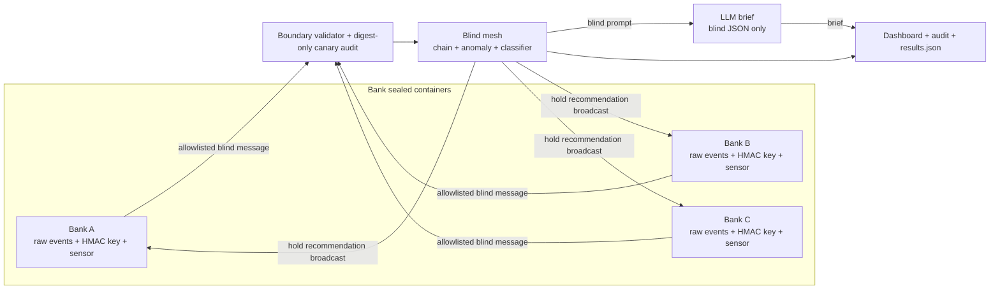

# Z-SPECTRA | SSF2026

**Team:** Z-SPECTRA<br>
**Submission:** SSF2026

Start with the [architecture flowchart](#architecture-flowchart), [results](#results), or [LinuxONE deployment notes](#linuxone-preflight).

Z-SPECTRA is a synthetic cross-bank mule-cascade demonstrator. Each bank service processes synthetic raw events locally, uses HMAC-SHA256 to create pseudonymous BIDs, and sends only the frozen bank-to-mesh fields. The mesh links blind features, scores chains, and sends a hold recommendation for operator review. Rollback counts are simulated rollback telemetry.

The project emphasizes its privacy boundary, boundary audit, and measured decision latency. It uses synthetic events only; a hold is a recommendation for bank-operator review.

## Open-source libraries

- [NumPy](https://numpy.org/) — feature arrays and evaluation calculations.
- [scikit-learn](https://scikit-learn.org/) — Isolation Forest and HistGradientBoosting models.
- [Flask](https://flask.palletsprojects.com/) — bank, mesh, dashboard, and replay HTTP services.
- [Requests](https://docs.python-requests.org/en/stable/) — service-to-service HTTP calls.

## Architecture flowchart



The replay controller is a test harness with no consortium key. Generated canaries and raw replay data stay under `demo-data/`; the mesh receives only the digest-only canary index. The raw replay directory is not mounted into the mesh or dashboard. BIDs are pseudonymous and linkable, not anonymous.

## LinuxONE preflight

Run these commands on the L1CC VM. They report the host architecture, byte order, whether NumPy, scikit-learn, Flask, and requests import, and whether the Docker CLI and daemon respond:

```sh
python3 tools/linuxone_preflight.py
```

To test a clean pip installation without changing the VM's system packages, run:

```sh
python3 tools/linuxone_preflight.py --install-check
```

The clean install uses a temporary directory and removes it afterward. The Docker CLI/daemon check and clean pip check are separate: successful Python imports alone do not prove that all four images build. `./run.sh start` performs the actual image builds when Docker is selected.

To check whether pip has binary wheels for the ML stack on the current host, without compiling anything, run:

```sh
python3 tools/linuxone_preflight.py --wheel-check
```

The mesh container uses Ubuntu's architecture-specific NumPy, SciPy, and scikit-learn packages. The other containers use the smaller Python base image with Flask and requests. The wheel check reports pip availability only; the target-host Docker image build is the compatibility check for the chosen container packages.

The mesh image needs NumPy and scikit-learn. The bank, dashboard, and replay images install only Flask and requests. The default runner mode is `auto`: it uses Docker when the CLI and daemon are available, otherwise it starts isolated localhost-bound processes. Force a mode with `ZSPECTRA_MODE=docker` or `ZSPECTRA_MODE=process`.

Process mode is a functional fallback, not container-equivalent isolation: each service gets a separate environment, the consortium key is passed only to bank processes, and ports bind to loopback, but the services run under the invoking OS account. Use Docker when the demo needs container isolation.

For x86 local development, set `ZSPECTRA_REQUIRE_S390X=0`; this allows a development run but does not establish LinuxONE compatibility.

### Optional DFLTCC path

DFLTCC stays disabled by default. On a LinuxONE s390x host, enable it for a run with `ZSPECTRA_DFLTCC=1 ./run.sh demo`. The runner requires the `dflt` CPU feature and a DFLTCC-capable loaded zlib before training or starting services. It uses `DFLTCC_LEVEL_MASK=0x007e` by default; override that only when the target's zlib documentation supports the selected value. The setting is passed to bank containers, which independently check their own CPU and zlib at startup. Prepared models are retrained when the event count, seed, or zlib/DFLTCC profile changes, keeping compression features consistent between training and inference.

DFLTCC changes the compression implementation used by the sensor's level-six features, so measure detection results and zlib timing on the target before choosing it for a deployment. The benchmark isolates enabled and disabled measurements in fresh Python processes. A benchmark result can show that the accelerated path is available and faster for its buffers; it does not establish production throughput. See IBM's [zlib acceleration features](https://www.ibm.com/docs/en/linux-on-systems?topic=compression-features), [application overrides](https://www.ibm.com/docs/en/linux-on-systems?topic=overrides-applications), and [acceleration verification](https://www.ibm.com/docs/en/linux-on-systems?topic=compression-confirming-acceleration).

Bank startup rejects a mismatch in compression level or DFLTCC settings. A different zlib version is logged because host and container base images can package different releases; validate recall and feature distributions on the target when that warning appears.

The sensor also maintains rolling transaction and destination counts and a bounded byte window, compresses the reference once, and reuses outbound HTTP sessions through a bounded exclusive-use pool. These are implementation changes; no speedup percentage is claimed until a target run records it in `results.json`.

## Run the demo

Set a fresh key in the shell and start the scripted heist. The default preparation size is `DEMO_EVENTS=20000`.

```sh
export CONSORTIUM_KEY="$(python3 -c 'import secrets; print(secrets.token_hex(32))')"
./run.sh demo
```

Open `http://127.0.0.1:8080`. Use `./run.sh status` to check the services, `./run.sh reset` to clear demo state, and `./run.sh stop` to stop the services. Process-mode logs are under `.run/logs/`.

`./run.sh eval` writes observed measurements to `results.json`; its default evaluation uses `DEMO_EVENTS=20000`, three seeds, and ten live repeats at each replay speed (1x, 5x, and 10x). It reports alert decision latency and end-to-end hold-delivery latency at each speed, plus remaining transfer value and alert timing from held-out ground truth. Override the data size, seed count, and repeats with `DEMO_EVENTS`, `EVAL_SEEDS`, and `EVAL_LIVE_REPEATS`. Ten repeats give a basic spread estimate; p99 is still rough at this sample count. The evaluation is a synthetic demonstration, not a production efficacy result.

## Docker and LLM connectivity

In Docker mode, `host.docker.internal` reaches the host through the gateway configured by `run.sh`. The LLM service must listen on an address reachable from Docker. On the LinuxONE VM, check:

```sh
ss -ltnp | grep 8082
docker ps
```

If the listener is only `127.0.0.1:8082`, restart the Lab 2 or Granite server with `--host 0.0.0.0`, or use `ZSPECTRA_MODE=process ./run.sh demo`. Check `llm_mode` in the dashboard after the heist: `template` means the configured local/API call was unavailable or failed. `docker ps` should show the services when Docker mode is active; use `ZSPECTRA_MODE=process ./run.sh status` for the process-mode check.

## LLM brief

The mesh calls the OpenAI-compatible chat endpoint at `LLM_URL` with `LLM_MODEL` and optional `LLM_API_KEY`. The default endpoint is the Lab 2 service on the host at `http://host.docker.internal:8082/v1/chat/completions` in Docker mode, and `http://127.0.0.1:8082/v1/chat/completions` in process mode. The request uses a 60-second timeout, `max_tokens=150`, and `temperature=0.2`; failures use a labeled template brief.

```sh
export LLM_URL=http://127.0.0.1:8082/v1/chat/completions
export LLM_MODEL=your-loaded-granite-model
ZSPECTRA_MODE=process ./run.sh demo
```

The Docker mesh container gets `--add-host=host.docker.internal:host-gateway`, and `run.sh` sets `LLM_URL` to that host endpoint. The exact compact blind JSON shown in the dashboard is sent as the user message; the separate system message contains the safety instructions. The payload is validated and scanned before sending, and the response is scanned before display. `llm_mode` is `local`, `api`, or `template`; the dashboard shows a pending alert immediately and fills in the brief when generation completes. `LLM_API_KEY` is passed only to the mesh process/container.

The endpoint must expose `POST /v1/chat/completions` with the OpenAI chat-completions request shape.

## Results

`bench/bench.py` writes the measured evaluation to `results.json`; the dashboard reads its numbers from that file. The evaluator also refreshes the snapshot below from the generated JSON. Commit both files with the submission after the evaluation-host run.

<!-- EVAL-SUMMARY-START -->
No measured results are attached to this checkout yet. Run `EVAL_LIVE_REPEATS=10 ./run.sh eval` on the evaluation host to generate `results.json` and this summary.
<!-- EVAL-SUMMARY-END -->

The data is synthetic and follows authored scenario rules, so the measured recall is specific to this benchmark. It does not establish production detection capability. The digest-only canary audit detects exact complete tokens; partial or altered canary text may go undetected. DFLTCC is opt-in and disabled by default. A DFLTCC flag alone does not prove that the loaded zlib used hardware acceleration; report the measured toggle comparison and whether the application runtime was configured separately.

For evidence from the target VM, run `python3 tools/platform_proof.py` there. For the frozen wire contracts, privacy zones, evaluation protocol, and acceptance criteria, read [SPEC.md](SPEC.md).
